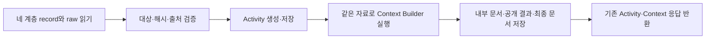

# 빠른 분석의 준비·조회 시간 개선

## 최신 확인: EC2 실제 Front의 새 URL 5건 — 2026-10-06

현재 Front는 준비된 EC2 수집·Activity·Builder와 Judgment26/Sonnet 5.5를 사용한다.
Context20/L23:19를 고정해 정상 주소 2건과 실행 전에 선정한 공개 피드 주소 3건을
실제 로그인 화면에서 한 번씩 접수했다. VT는 선택하지 않았다.

| 대상 | Front 결과 수신 | 병렬 수집·분석 | Activity | Builder | 모델 요청·응답 |
|---|---:|---:|---:|---:|---:|
| GNU Bash | 32.70초 | 20.661초 | 0.080초 | 0.182초 | 9.723초 |
| 새 피드 표본 1 | 20.58초 | 1.813초 | 0.076초 | 0.141초 | 16.614초 |
| Blender | 11.68초 | 1.415초 | 0.151초 | 0.266초 | 8.335초 |
| 새 피드 표본 2 | 20.51초 | 10.249초 | 0.098초 | 0.178초 | 8.373초 |
| 새 피드 표본 3 | 14.44초 | 2.205초 | 0.065초 | 0.136초 | 9.872초 |

Front 표시값은 0.01초로 반올림된다. 모델 구간에는 SDK 전송·제공자 대기가 포함된다.
병렬 수집에는 L0/L1/L23의 수집·분석·저장이 포함되며,
Activity·Builder·장부 기록을 포함한 EC2 전체 묶음과 중복 합산하지 않는다.

GNU는 공유 HTTP 연결 실패와 별도 TLS 시간 초과가 기록됐다. 별도 TLS를 포함한
L2 native는 10.120초, L3 native는 0.054초였으며 공유 HTTP 실패 앞 구간의 정밀 span은
없다. 20.661초 전체를 Lambda 준비나 Python 계산이라고 부르지 않는다.
새 피드 표본 2의 L3 native 9.480초는 외부 JS 수집·분석을 포함하고 둘은 미분리다.
이번 값으로 모든 URL의 속도 개선이나 판정 품질 해결을 주장하지 않는다.

고정 자료와 남은 문제는 [실제 5건 결과](../../../remediation-20261006/fast-verdict-review/ACTUAL-FIVE-RESULTS.md),
[독립 검토](../../../remediation-20261006/fast-verdict-review/five-front-runs-v5-independent-review.md)를 따른다.

## 이전 확인: 원래 SFN 경로의 실제 개선 — 2026-10-05

처음 문제가 된 **L0/L1/L23 병렬 수집 12.340초**의 원래 fast-result SFN 경로에서
다시 측정했다. 실제 수집부터 Sonnet 5.5 판정·사용자 결과 생성까지 세 실행 모두
성공했다. Activity와 Context는 별도 Task로 유지해 원래 단계별 timeout·retry·실패
흐름을 보존했다.

| 동일한 SFN 흐름 | 병렬 수집 | Activity | Context | 세 비모델 구간 합계 | Judgment 상태 | 전체 SFN |
|---|---:|---:|---:|---:|---:|---:|
| 기존 코드, 새 실행환경 | 3.957초 | 2.131초 | 0.769초 | 6.857초 | 8.982초 | 16.451초 |
| 개선 코드, 사전 준비 후 첫 요청 | 0.703초 | 0.310초 | 0.447초 | 1.460초 | 8.474초 | 10.479초 |
| 개선 코드, 같은 환경의 후속 요청 | 0.490초 | 0.255초 | 0.402초 | 1.147초 | 7.732초 | 9.401초 |

같은 시점의 기준선 대비 세 구간은 **5.397초, 78.7% 감소**했다. 최초 실행의
15.306초와 새 후보 1.460초 차이 전체를 코드 개선량으로 계산하지 않는다.
Judgment에는 모델 통신 외 SDK·S3·응답 처리가 포함되며, 순수 provider 시간이
저장되지 않아 위 Judgment 숫자를 순수 모델 추론 시간으로 부르지 않는다.

### 적용한 구성과 기능 보존

- 고정 버전: L0 `:12`, L1 `:12`, L23 `:13`, Context `:13`.
- 네 역할 2048MB, `aws_prepared_entry.handler`, 환경당 SDK 공유, 필요 import 사전 준비.
- Context 계층 입력 병렬 읽기와 중복 GET 제거. **분리 Task 기준 21→17 GET, 4 PUT 유지**.
- 네 버전에 PC 각 1개를 준비하고 READY 이후 요청. 첫 설정 요청→전체 READY는 약 87.7초.
- 각 환경의 실제 INIT_REPORT 0.624~1.420초가 요청 전에 기록됨. PC 호출은 생산자 각 2회,
  Context 4회이며 spillover 0회. 결과 캐시 없이 매번 새로 수집.
- 실제 세 입력 각각을 기존 코드/r3로 격리 재생. raw/native→record, 네 저장물 bytes,
  최종 Messages user와 공개 Result 연결이 실제 AWS 결과와 일치. 독립 검토 완료.

**상태:** 개선 코드·고정 버전·원래 경로의 실측은 확보했다. 실험 후 PC와 임시 권한을
제거하고 SFN을 직전 snapshot으로 복원했다. 일반 API를 전환하거나 준비 용량을 상시
활성화한 상태는 아니다. 이 구성을 유지하려면 지속 적용 절차가 필요하다. 준비 용량만의
30일 비용은 저장된 서울 요율 기준 약 US$106.28이며 호출·기타 서비스 비용은 별도다.

[최신 HTML 보고서](../../../remediation-20261004/performance-round2/original-bottleneck/performance-report.html),
[원래 경로 전체 시간표](../../../remediation-20261004/performance-round2/original-bottleneck/aws-live/run/ORIGINAL-PATH-TIMING.md),
[동일 입력 독립 검토](../../../remediation-20261004/performance-round2/preservation-review.md),
[지속 적용 구성](../../../remediation-20261004/performance-round2/original-bottleneck/sustained-candidate/README.md).

아래는 앞서 수행한 **직접 호출·결합 후보 실험의 기록**이다. 결합 후보의 8 GET이나
후속 요청 약 0.9초 개선을 위 원래 SFN 실측과 혼합하지 않는다.

## 이전 직접 호출 실험 당시 상태

**원래 요청과 비교 기준:** 처음 지적된 2026-10-03 SFN 실행은 병렬 수집 12.340초,
Activity 2.164초, Context 0.802초로 세 구간 합계 **15.306초**였다. 이번의
후속 요청 1.570 → 0.674초는 환경 재사용 조건에서 약 **0.896초** 줄인 결과다.
수정하지 않은 기존 코드도 이번 직접 호출 첫 요청에서는 6.574~6.874초였다.
원래 SFN과 이번 직접 호출은 실행 시점·환경 준비·측정 경계가 달라, 그 차이 전체를
코드 개선 효과로 돌리지 않는다. **원래 SFN 경로의 첫 요청 지연을 안정적으로
해결했다는 종단 검증은 아직 완료하지 않았다.**

2026-10-04의 두 번째 성능 후보다. 실제 CodeBuild에서 L0·L1·L23 이미지 생성과
기존 dependency 버전·새 준비 진입점 검사를 마쳤고, **3 trial × 기준선/후보 ×
첫/후속 요청의 12개 job, 54개 Lambda 호출**을 완료했다. 모든 job이 성공했다.
측정 범위는 직접 Lambda 호출의 수집 → Activity → Context이며 Gate·Step Functions
상태 전환·Result API·모델 호출은 포함하지 않는다. 일반 API/SFN 연결은 전환하지 않았다.

| Trial | 기존 첫 요청 | 개선 첫 요청 | 기존 후속 요청 | 개선 후속 요청 |
|---|---:|---:|---:|---:|
| 1 | 6.586초 | 10.216초 | 1.630초 | 0.862초 |
| 2 | 6.574초 | 4.111초 | 1.568초 | 0.674초 |
| 3 | 6.874초 | 4.226초 | 1.570초 | 0.665초 |

후속 요청 중앙값은 **1.570 → 0.674초, 57.1% 감소**했다. 첫 요청은 두 trial에서
빨라졌으나 한 번은 더 느렸다. 그 호출의 L1 INIT은 8.259초, handler는 0.348초였다.
INIT 안의 import와 AWS 플랫폼 준비를 더 잘게 나누는 로그는 없어 원인을 단정하지 않는다.
이 표본으로 첫 요청 지연이나 p95를 보장하지 않는다.

같은 실제 12개 입력을 기존 코드와 동결 r3 코드로 다시 처리한 24개 격리 실행에서
각 입력의 네 저장물 bytes가 실제 AWS 저장물과 동일했다. 모델 본문·공개 사실·내부
매핑·revision과 입력 불변도 확인했다. 이는 해당 입력의 기능 보존 근거다.

### 준비 용량을 사용한 추가 실측

같은 개선 버전 네 개에 Provisioned Concurrency를 각각 1개 지정한 뒤 새 job 세 개를
실행했다. 별도 **3 job / 12 호출**이며 첫 요청 1회 + 같은 환경 후속 요청 2회다.

| 요청 | 병렬 수집 | 수집 → Context 전체 |
|---|---:|---:|
| 준비 완료 후 첫 요청 | 0.662초 | 1.110초 |
| 후속 1 | 0.373초 | 0.665초 |
| 후속 2 | 0.373초 | 0.663초 |

네 환경의 설정 시작 → 모두 READY 관측까지 **87.712초**가 걸렸다. 이 준비는 요청을
받기 전에 끝내야 하며, 첫 요청 1.110초에 준비 시간이 포함된 것처럼 표현하지 않는다.
실제 INIT_REPORT는 역할별 0.664~1.506초이고 22:43:55~57 KST에 끝났다.
그 뒤 전체 READY 관측 22:45:21.832 KST까지 대기가 있었다. 87.712초 전체가
우리 Python 초기화 시간이라는 뜻은 아니다.
CloudWatch에서 각 역할의 준비 용량 호출 3회·spillover 0회를 확인했다. 각 역할의
같은 환경 ID와 1 → 2 → 3 실행 차수도 확인했다. 결과 캐시 없이 매 요청 새로 수집한다.

서울 x86 실제 Pricing API 요율 기준 4개 × 2GB를 30일 유지하는 용량 비용은 약
**US$106.28**다. 호출·초기화·S3·기타 비용은 별도다. 준비 수량을 넘는 동시 요청은
일반 용량으로 처리될 수 있다. 상시 용량을 켜 두지 않은 현재 운영 환경에 이 시간을
그대로 적용하지 않는다. [AWS 준비 용량](https://docs.aws.amazon.com/lambda/latest/dg/provisioned-concurrency.html),
[AWS 요금 체계](https://aws.amazon.com/lambda/pricing/).

추가 세 실제 입력의 12개 저장물도 기존 코드·r3·실제 AWS bytes가 같았다.
실험 후 준비 용량 네 개는 22:45:26 KST까지 해제·부재 확인했고, 승인된 임시 정책
`performance-round2-20261004`는 22:48:07 KST에 삭제·부재 확인했다.
일반 API·SFN·코드·설정은 같다. PC 제어 작업으로 RevisionId만 바뀌어 최초 엄격
비교는 false였으며, 이 결과를 보존한 뒤 ARN·버전·코드·설정의 동일성을 따로 확인했다.

[읽기 쉬운 HTML 보고서](../../../remediation-20261004/performance-round2/performance-report.html),
[전체 시간 경계](../../../remediation-20261004/performance-round2/final-timing/TIMING-BREAKDOWN.md),
[준비 용량 상세](../../../remediation-20261004/performance-round2/final-timing/PC-TIMING.md).

이전 후보는 재사용 실행이 빨라졌지만 첫 실행이 느려졌다. 이번에는 전체 요청 시간에
준비 시간을 포함하여 비교한다. [실험 자료](../../../remediation-20261004/performance-round2/BENCHMARK-README.md)와
[독립 검토](../../../remediation-20261004/performance-round2/preservation-review.md)를 함께 본다.

## 바꾼 부분

| 부분 | 기존 작업 | 후보 작업 |
|---|---|---|
| Activity와 Context | 각각 입력을 읽고 별도 Lambda 호출 | 입력을 한 번 검증한 뒤 한 호출에서 두 작업 수행 |
| 공통 입력 읽기 | 한 계층씩 읽음 | 네 계층을 함께 읽되 계층 안에서는 record → raw 순서 유지 |
| 필요한 모듈과 SDK | 일부를 첫 handler 실행 중 준비 | 별도 진입점에서 항상 필요한 도구를 미리 준비 |
| CPU 할당 | L0·L1·Context 512MB, L23 2048MB | 비교 후보는 네 역할 모두 2048MB |

이전 r2의 Activity·Context 합계 17 GET이 결합 후보에서는 8 GET으로 줄어든다.
원래 기준선의 21 GET과 구별한다. 저장은 Activity·내부 Context·공개 pending/result·최종
문서의 4 PUT을 유지한다. 실제 후보 6개 결합 호출에서 **8 GET / 4 PUT**을 확인했다.
후속 결합 handler는 0.251~0.310초였고 Builder 계산은 35.7~37.7ms였다.
공통 GET의 겹침을 제거한 경과 시간은 59.6~124.3ms, PUT은 139.0~151.8ms였다.

## 기능을 유지하는 경계

- 매 요청에서 이번 입력을 다시 읽고 검증한다. 이전 URL의 분석 결과를 재사용하지 않는다.
- raw·record·모델 본문·공개 사실·내부 매핑의 내용을 바꾸지 않는다.
- 원래 계층 순서로 오류를 확인하고, 병렬 읽기 중 실패해도 시작한 worker의 종료와 Body 닫힘을 기다린다.
- Activity의 immutable 저장이 성공해야 Context를 시작한다. 같은 key에 다른 내용이 있으면 기존처럼 실패한다.
- Activity와 Context가 각각 호출되는 기존 진입 경로도 제공한다.
- L0/L1/L23의 검사, 수집 한도, 외부 접근 방어와 실패 상태는 바꾸지 않는다.

네 기존 실제 입력에 대해 r2 분리·r3 분리·r3 결합·준비 진입점 결합을 재생했다.
각 입력의 네 저장물 bytes와 기존 두 응답이 같았다. 이는 같은 입력에서의 보존 증거이며,
새 Lambda 실행의 속도나 전체 서비스 품질을 대신하지 않는다.

## 결합 후보의 배포 연결 — 최신 분리 Task 실측과 별도

- 준비 진입점: `evidence_pipeline.aws_prepared_entry.handler`.
- Context 환경변수 `EVIDENCE_PARALLEL_READS=1`로 계층별 동시 읽기를 켠다.
- 진단용 `EVIDENCE_TIMING=1`은 실행 단계와 S3 작업의 시간을 기록한다.
- 이미지 함수에는 원래 `ImageConfig.Command` override가 있으므로 Docker CMD만 바꿔서는 적용되지 않는다.
- 결합 요청은 `operation=activity_context`이고 반환은 `{activity, context}`다.
- `deployment/build_combined_context_candidate.py`는 fast-result 패치를 마친 저장 ASL에 적용한다.
  ActivityTask가 결합 결과를 받고 ContextTask는 기존 `$.context.ctx` 경로에 값을 놓는 Pass가 된다.
  이후 안전 분기·상태 저장·Judgment·Result가 쓰는 경로는 같다.

결합한 배포에서 총 명목 실행 예산을 유지하려면 기존 55초 두 호출을 Lambda 110초,
Step Functions 60초 두 Task를 결합 Task 120초로 옮길 수 있다. 이는 **단계별 제한을
하나의 총 제한으로 바꾸는 운영 설정 변경**이다. 55초씩의 단계별 중단 조건과 같다고
표현하지 않는다. 이번 성능 비교의 Context 함수 timeout은 원래 55초를 유지한다.

Activity 저장 후 Context가 실패하면 Activity 원본은 S3에 남고, 결합 호출은 실패한다.
기존 MarkFailed 경로로 종료하여 모델을 호출하지 않는다. 결합 호출 성공 후 MarkContext의
상태 저장이 실패하면 이미 반환된 Activity·Context 값에 오류가 추가된다.

## 시간을 읽는 방법

| 구간 | 포함하는 작업 | 해석 |
|---|---|---|
| 측정한 요청 경과 시간 | 직접 호출한 병렬 수집과 이후 Activity·Context 호출 | 모델 판정 전 구간의 대기 시간 비교 |
| Lambda Init | 실행 환경 초기화와 우리 모듈·SDK 준비 | 전부 AWS 내부 준비라고 분류하지 않음 |
| Lambda Duration | handler와 그 안의 조회·분석·저장 | 코드 계산과 외부 대기를 다시 나누어 읽음 |
| S3 span | 객체 GET/PUT 요청·응답 처리 | 겹쳐 실행된 span 합계를 실제 경과 시간과 구별 |
| Builder span | 문서·공개 사실·매핑 구성 | S3 조회·저장을 별도 표시 |
| 나머지 경과 시간 | 호출 전송·AWS 호출 경로 등 계측 밖 구간 | 원인이 직접 측정되지 않은 잔여 시간 |

결합 호출의 공통 8 GET은 `activity_context.total` 안에 있지만 `activity.total`과
`context.total` 밖에 있다. 두 하위 시간의 합만으로 전체를 계산하지 않는다.
준비 작업을 Init으로 이동한 것 자체를 절감량으로 잡지 않는다. CPU 할당도 바뀌므로
측정된 차이는 네 변경을 함께 적용한 후보의 효과다.

Lambda는 설정한 메모리에 비례하여 CPU를 할당한다. 따라서 이번 메모리 증가는 CPU가
필요한 준비·분석 시간을 줄이려는 선택이다. 실제 비용은 로그의 Billed Duration과 할당
메모리로 GB-s를 비교한다. [AWS 메모리 설정](https://docs.aws.amazon.com/lambda/latest/dg/configuration-memory.html),
[AWS 실행 환경 수명 주기](https://docs.aws.amazon.com/lambda/latest/dg/lambda-runtime-environment.html).

## Front 영향

Front가 사용하는 `fast-result-1` 공개 JSON, 사실 항목과 판정 이유 연결, 상태 값은 같다.
결합 응답은 내부 작업 연결에만 쓰인다. Front에 raw·S3 매핑·성능 진단 span을 전달하지 않는다.
따라서 이 후보를 위해 Front의 표시 문구나 결과 파싱을 변경할 필요는 없다.
