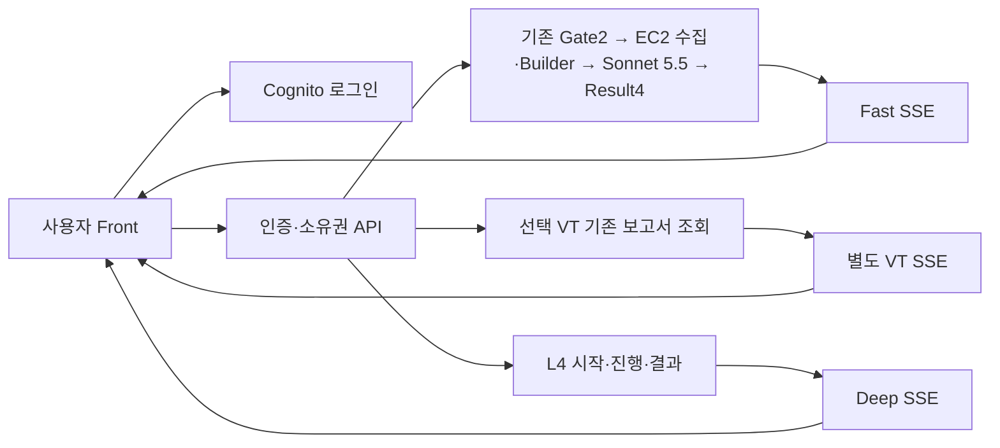

# 실제 서비스 배포 확인 — 2026-10-06

서비스: [Team5 URL 분석](https://d2gmygchoew9ed.cloudfront.net/). Front 담당자는 [디자인·연동 사용법](../frontend/README.md)을 따른다. 확정 모델 지시와 공개 결과 구조는 [Notion 설계](https://app.notion.com/p/2ae3dea100f783c596d901663edab660)에 있다.

현재 Fast 내부 버전은 Context20·Judgment26·L23:19이며 Gate2·Result4·Front 인증과 소유권 계약은 유지한다.
배포 뒤 실제 로그인 화면에서 새 URL 5건의 모델 호출과 결과 수신을 확인했다.
의심 응답의 정상 대안·공개 문구와 일부 중첩 JS 분석 범위 문제는 남아 있다.
GitHub 원격 게시는 사용자가 정한 보완·독립 검토 완료 조건에 따라 아직 진행하지 않았다.

## 배포 구조

| 구성 | 실제 적용 |
|---|---|
| Front | CloudFront + private S3 정적 파일. `/api/*`는 인증 API로 전달 |
| 로그인 | Cognito authorization code + S256 PKCE. 토큰은 브라우저 메모리에만 보관 |
| API | Regional REST API, Cognito access JWT·분석 scope·사용자 소유권 확인 |
| Fast | 기존 Gate2/Result4 고정 버전 호출. 수집·Activity·Builder는 준비된 EC2 worker |
| VT | 별도 Lambda + durable Step Functions 대기. API key는 Secrets Manager |
| Deep | 별도 배포된 L4 start/query를 호출. L4가 직접 초기 캡처·추가 관측을 수행 |
| 진행 수신 | Bearer header를 사용한 Lambda response streaming SSE. 브라우저 반복 조회 없음 |

VT 결과는 Builder·Sonnet 판단·L4 입력에 넣지 않는다. VT 미선택 Fast 경로에서는 VT I/O를 하지 않는다. Fast 원본·Record·S3 매핑과 모델 내부 사고과정은 사용자 응답에 제공하지 않는다. L4 추가 캡처·페이지 통신 기록은 소유 사용자가 접힌 자료 영역에서 연다.

## 실제 확인한 결과

실제 Cognito 로그인 후 새 URL `https://www.rust-lang.org/`를 접수했다. 기존 Sonnet 5.5 호출 한 번으로 `LIKELY_BENIGN` 결과를 받았으며, 화면에는 ‘정상 가능성 높음’으로 표시된다.

- 61개 상세 사실에 모두 코드가 만든 쉬운 설명이 있었다. 모델이 선택한 근거 12개가 해당 사실에 연결됐다.
- 실제 Messages의 user 본문은 같은 요청의 Builder `model_body`와 같았다. 최종 Result4 응답은 저장된 공개 result와 같았다.
- 선택 VT는 기존 검사 92개 중 위험 표시 0개·의심 표시 1개를 별도로 표시했다. VT 때문에 우리 판정을 바꾸지 않았다. 자료 시각은 10월 3일, 조회 시각은 10월 6일로 구별했다.
- 같은 Fast 결과의 네 식별자로 실제 L4를 시작했다. 캡처·모델 1회와 최종보고가 완료됐다. 이번 Manager는 추가 Tool 작업을 선택하지 않았다.
- 배포된 Front 8개 파일은 현재 소스와 byte hash가 같았다. 새 웹 Lambda 3개의 실제 ZIP 안 `web_service` 6개 파일도 소스와 같았다.
- 인증 없는 API 요청은 401이었다. 실제 로그인·Fast SSE·VT SSE·Deep SSE 수신은 브라우저에서 확인했다.
- 실제 자료 링크에서 발견한 S3 지역 주소·서명 불일치는 L4 query 4의 지역 endpoint 지정으로 수정했다. 같은 실행의 PNG·통신 기록 GET은 200과 redirect 0이었고, Front에서 캡처 링크를 클릭해 실제 1280×720 Rust 화면이 열리는 것도 확인했다. 보고 내용·FILE 24개·권한·기존 실행은 유지됐다.
- 진행 화면은 기존 Canvas 완료 실행으로도 확인했다. 업무 1개·작업 3개·도구 실행 7개와 시간순 내역 29개를 표시하고, 해당 기록을 누르면 연결된 작업·도구 실행·결과를 펼쳤다. 같은 완료 실행을 재사용했으며 새 모델 호출은 하지 않았다.

## 시간: 같은 Rust 요청

브라우저 접수 시작부터 최종 Fast 결과 수신은 **9.902초**다. AWS 로그의 모델 서비스 요청·응답 구간은 **6.741초**, 나머지 전체 구간은 **3.161초**다. 모델 서비스 구간은 네트워크 전송과 제공자 대기를 포함하며 순수 추론 시간으로 부르지 않는다.

| 측정 경계 | 시간 |
|---|---:|
| Gate handler: 정책·접수 저장·SFN 시작 | 0.260초 |
| SFN AllocAttempt | 0.138초 |
| EC2 PreparedWorkerTask: 수집·Activity·Builder·저장·callback | 1.563초 |
| SFN JudgmentTask 전체 | 7.325초 |
| 그중 provider transport | 6.741초 |
| JudgmentTask에서 provider를 제외한 구간 | 0.584초 |
| SFN MarkJudged | 0.147초 |
| 최종 공개 Result handler | 0.037초 |

SFN 실행 전체는 9.244초다. Gate·SFN·provider·Result는 일부 포함·겹침 관계이므로 표의 행을 합산하지 않는다. 실제 Judgment handler는 7.164초이며, 그중 provider 외 handler 작업은 0.423초다. Task와 handler 차이 0.161초를 모두 Lambda 준비 시간이라고 해석하지 않는다.

이 수치는 실제 한 요청의 관측이다. 모든 URL의 지연·모델 품질이나 L4 모든 도구의 정상 동작을 보장하지 않는다. 이번 웹 연결 작업은 Builder 출력 기능과 기존 Fast 판정 경로를 변경하지 않았다.

심층분석은 같은 요청의 SSM 실행 구간 39.229초, L4 runner `execute()` 구간 34.273초였다. runner는 준비·브라우저·캡처·모델/Store·전송·종료·최종 readback을 포함하고 SSM 대기·컨테이너 준비·Front 왕복은 제외한다. Manager 기록 구간 30.954초를 순수 모델 추론 시간으로 해석하지 않는다. 이 세 구간도 서로 포함되므로 합산하지 않는다.

## 검증·운영 경계

사용자 소유권·VT 독립성·한도·SSE·이전 요청 취소·Front 배포 모듈 포함에 대한 로컬 검사는 Python 14개다. Node 검사는 기존 연결 6개와 Notion 진행 계약 9개, 총 15개다. 독립 검토에서는 같은 실제 Builder→Messages→provider→공개 결과, AWS 배포 소스와 L4 네 입력의 연결을 대조했다. 검사 통과를 모든 URL의 의미 판단 품질로 확대하지 않는다.

업무→작업→도구 실행→결과의 화면 관계는 기존 10월 2일 SDK/Store 기록으로 별도 재생했다. 업무 1개·직접 Tool 작업/Agent 작업 2개·도구 실행 8개의 부모 연결, 원래/준비 입력 문자열과 도구 결과/작업자 보고의 구분을 대조했다. 이는 기존 로컬 브라우저·통제 모델·메모리 AWS 기록의 화면 검증이며 현재 Rust AWS 요청의 추가 Tool 실행으로 합산하지 않는다.

준비·실행·보고 도착·총괄 검토·판단 대기·전송 마무리의 표시와 갱신 후 펼침 유지는 문서 기준의 검사와 기존 SDK 재생으로 확인했다. 실제 공개 사이트에서는 Canvas 완료 기록의 표시·참조 이동을 확인했다. 실행 중 모든 전환을 새 AWS 실행에서 관찰한 것은 아니며, 해당 Canvas 기록의 초 이하 원시 시각 순서는 자료가 없어 미확인이다.

무료 VT key의 서버 전체 한도는 16초 간격·500회/UTC일·15,500회/UTC월이다. 조회 실패·한도 대기는 VT 영역에서 처리한다. 상용 서비스에서는 [VT 공식 조건](https://docs.virustotal.com/reference/public-vs-premium-api)에 맞는 계약의 key가 필요하다.

모든 원본 증거·SDK readback·브라우저 캡처는 로컬 검증 폴더에 보존한다. API key·QA 비밀번호·JWT·서명 URL·원본 model wire는 GitHub에 올리지 않는다. 검증 계정 두 개는 전역 로그아웃 후 비활성화했고 `Enabled=false`를 확인했다. 계정·분석 기록은 삭제하지 않았다. 배포 스크립트 `--phase rollback`은 새 Front/API의 가역적 중단을 지원한다.

L4 start/query 구현은 별도 L4 작업이 관리한다. 이 저장소의 웹 배포만으로 L4 실행 서비스를 새로 만들지 않으며, 이미 승인·배포된 named 함수에 연결한다. 배포 시 해당 함수와 현재 Fast 버전이 존재하는지 확인해야 한다.
