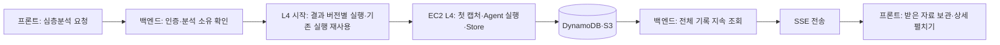

# L4 백엔드 — 시작, 저장 조회, SSE 전달

백엔드는 로그인한 사용자의 심층분석 요청을 접수하고, L4가 저장한 진행·업무·작업·행동·보고·파일 정보를 계속 읽어 SSE로 보낸다. 프론트는 받은 자료로 목록과 상세를 표시한다.

## 시작 요청과 첫 총괄 입력

프론트는 현재 Fast 결과의 `job_id`, `attempt`, `context_revision`, `result_revision` 네 식별자와 선택 `request_text`로 `POST /api/analyses/{scanId}/deep`을 요청한다. 백엔드는 Cognito access token과 분석 소유를 확인하고, 네 식별자가 현재 Fast 결과와 같은지 대조한다. 요청문은 앞뒤 공백 제거 후 최대 2,000 Unicode 문자·UTF-8 8,000 bytes이며 빈 값은 생략한다.

시작 함수는 같은 네 식별자와 같은 요청문의 기존 L4 실행을 재사용한다. Fast 결과 버전이나 요청문이 달라지면 별도 실행 번호를 만들며, 원래 분석 번호·네 식별자·요청문을 함께 보관한다. 요청문 미입력은 기존 실행 식별 규칙을 유지한다. 시작 대기 기록을 먼저 저장하고, 승인한 EC2 한 대에 고정 SSM 명령을 보낸다.

**첫 브라우저 캡처는 L4의 책임이다.** EC2 L4가 URL에 접속해 PNG를 캡처한다. 총괄의 첫 입력은 기존 Builder 최종 모델 본문, Judgment 전체, 이 PNG다. 백엔드는 캡처를 만들어 전달하지 않는다.

선택 요청문은 총괄 첫 user 입력의 `request_text`로 추가한다. 기존 Builder 본문과 Judgment는 그대로 보존한다. 요청문을 관측 사실이나 시스템 지침으로 합치지 않으며, 총괄의 기존 조사 대상·Tool 권한·실행 한계는 유지한다. 2026-10-08 추가 기능은 로컬 구현·모형 전송 검사까지 확인했으며 실제 적용 상태는 [보완 기록](../evaluation/remediation-20261008/purpose-and-user-options-1/README.md)을 따른다.

## 저장된 기록을 SSE로 보내는 방법

프론트는 접수된 `run_id`의 `GET /api/deep/{runId}/events`에 연결한다. SSE 백엔드는 소유 RUN을 확인한 뒤 L4 조회 함수를 반복 호출한다. 조회 함수는 같은 L4 실행의 DynamoDB 기록을 강한 일관성으로 읽고, Query의 모든 페이지를 처리한다.

| 저장 자료 | 백엔드가 준비할 내용 | 프론트에서 사용할 관계 |
| --- | --- | --- |
| META·MANAGER | 전체 상태, 총괄 진행, 검토 업무·조회 상태·반환 및 배정 등록 상태 | 업무가 생기기 전 진행과 총괄 검토 표시 |
| WORK | 질문·이유·범위·답·답의 근거 | 업무 목록과 해당 작업 연결 |
| TASK | 업무 번호, 배정·선행 작업·대기 이유·실행 상태·결과 참조 | 업무 아래 작업과 그 행동 연결 |
| ACTION | 작업 번호, Tool 이름, 원래 인자·실제 준비 입력, 시작·종료·반환 참조 | 작업 아래 실제 Tool 실행과 결과 연결 |
| RESULT | 직접 Tool 반환 전체, 실행 Agent 보고 또는 총괄 최종 보고 | `result_ref`에 맞는 본문 표시 |
| FILE | 참조·종류·크기·해시·출처와 표시/다운로드 링크 | L4 캡처·페이지 통신 기록 등의 파일 열기 |

`reader.body()`가 작은 DynamoDB 본문과 큰 S3 본문을 공통으로 읽고 크기·해시를 확인한다. 백엔드는 W·T·ACT의 숫자 순서와 총괄의 실제 시작 시각으로 기록을 정렬한다. Tool 반환과 Agent 최종 보고는 공개 `kind`로 구분한다.

SSE는 `event: deep`에 진행과 전체 공개 기록을 전달한다. 완료 전에는 저장 변화를 계속 읽으며, `completed` 또는 실제 실행 중단의 `failed`를 전달한 뒤 연결을 끝낸다. 총괄 한 작업의 기술적 성공이나 업무의 답변 완료로 전체 완료를 표시하지 않는다. 일반 `GET /api/deep/{runId}` 조회도 제공하지만 상세 클릭에 사용하지 않는다.

프론트의 업무·작업·행동·결과 펼치기는 이미 수신한 자료를 사용한다. 파일 링크는 소유를 확인한 FILE의 실제 S3 위치로 발급하며 15분간 유효하다. 조회 함수는 서울 리전 S3 호스트를 직접 서명해 리다이렉트로 서명이 깨지지 않게 한다. PNG는 표시용 `inline`, 통신 JSON은 다운로드용 `attachment`로 제공한다. 파일 링크를 새 Tool 실행이나 상세 조회 요청으로 사용하지 않는다.

## 공개 응답과 내부 근거

모델 입력·ExecutionReport·Store 원문은 보존한다. 공개 보고의 근거 목록에서는 Fast 내부 `records/<scan_id>/...` 저장 키를 제외한다. 보고 문장·관측 한계와 L4 파일·업무·작업·행동·결과의 공개 참조는 유지한다. Fast 원본·내부 매핑·모델 요청/응답 보존 파일을 L4 FILE로 등록하지 않는다.

조회 Lambda는 직접 공개하지 않는다. 인증된 BFF/SSE 백엔드가 IAM 권한으로 호출하고 검증한 사용자 소유 정보를 전달한다. L4 조회는 해당 사용자 RUN을 먼저 확인한 뒤 L4 저장소를 읽는다. 모델 키는 EC2 Controller에서만 읽으며 시작·조회 Lambda와 Guest에는 전달하지 않는다.

## 구현 위치

| 책임 | 구현 |
| --- | --- |
| 인증·소유·최신 Fast 확인과 심층분석 접수 | `evaluation/remediation-20260911/repo/web_service/api.py` |
| SSE 소유 확인·지속 조회·완료/재연결 처리 | 같은 폴더의 `stream-core.mjs`, `stream.mjs` |
| L4 실행 번호·재사용·대기 상태·고정 실행 요청 | `src/l4_orchestrator/aws_start.py` |
| 소유 RUN 조회·L4 파일 링크 | `src/l4_orchestrator/aws_query.py` |
| 전체 본문·진행·결과·파일의 공개 snapshot | `src/l4_orchestrator/aws_snapshot.py` |
| DynamoDB 페이지 및 inline/S3 본문 읽기 | `src/l4_orchestrator/storage/aws_reader.py`, `aws_io.py` |
| 실제 EC2 실행·첫 캡처·모델·저장 | `deployment/run_job.py`, `src/l4_orchestrator/aws_runner.py` |
| 프론트 SSE 수신과 받은 기록의 상세 표시 | `evaluation/remediation-20260911/repo/frontend/service-client.js`, `deep-result-renderer.js` |

실제 AWS 입력·출력·DB·파일·HTTP 및 독립 검토 자료는 [검증 기록](../output/l4-aws-runtime-20261006/AWS-VERIFICATION.md)을 따른다. 실제 Rust 실행은 총괄이 바로 최종 판단해 Task·ACT가 없었다. 업무→작업→행동 상세는 기존 로컬 SDK/Store 기록을 현재 전달 형식으로 재생해 별도로 확인한다. 이를 실행 Agent의 실제 AWS 모델 호출 검증으로 설명하지 않는다.
